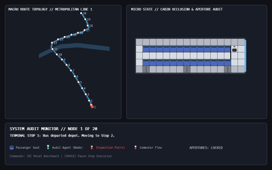

# Spatial Bottleneck & Inspection Policy Audit in Transit Topologies

[](https://github.com/AlibekBekzhigitov/Qoyanshyq)
[](https://www.python.org/)
[](https://doi.org/10.13140/RG.2.2.33086.24640)
[](https://doi.org/10.13140/RG.2.2.19446.56641)

A coupled continuous-discrete simulation framework (**Qoyanshyq Engine**) for modeling passenger turnover dynamics, spatial occlusion zones, aperture constraints, and inspection coverage efficacy within urban transit vehicles.

---

## 🚀 Dual-Scale Macro-Micro Simulation Framework

The repository spans three generations of evaluation engines: the statistical **Paired CRN Monte Carlo Audit** (`qoyanshyq_monte_carlo.py`, v3.2), the continuous dual-scale model (`Euclidean_dimension.py`, v3.0), and the baseline discrete grid automaton (`bus_grid_player.py`, v1.0).

| **Continuous Dual-Scale Model (`macro_micro_simulation.gif`)** | **Baseline Discrete Model (`simulation.gif`)** |
|:---:|:---:|
|  |  |
| *2D Euclidean Street Map coupled with Micro Cabin Audit* | *Discrete Grid Automaton (Baseline)* |

---

## 📐 Model Evolution & Architecture

### 1. Paired CRN Monte Carlo Coverage Audit (`qoyanshyq_monte_carlo.py` — v3.2)
Anchors the interior timing-race and line-of-sight model to five public Daimler Buses **Mercedes-Benz Citaro / eCitaro** configurations ($W = 2.55\,\text{m}$, driver bulkhead $\mathcal{B} = [0.0, 2.0] \times [0.95, 2.55]\,\text{m}$):
- **Common Random Numbers (CRN) Ablation:** Separates the opaque driver bulkhead's effect into a passenger early-warning suppression channel ($\Delta P_{\text{pass}}$), an inspector sightline occlusion channel ($\Delta P_{\text{insp}}$), and their interaction across Weidmann (1993) density regimes.
- **$t_{\text{blind}}$ Tipping-Point Sweep:** Evaluates deterministic inspector re-acquisition delays ($0.0\text{--}5.0\,\text{s}$) to locate exact sign-flip thresholds across vehicle lengths and door layouts.
- **Sequenced Aperture Control (`Interlocked Boarding`):** Evaluates secondary-door release delays ($\tau \in \{0, 2, 3, 4, 5, 6, 8\}\,\text{s}$) without increasing squad size ($k = 2$).
- **Multi-Seed Robustness:** Verifies cross-seed invariance across 5 independent master seeds (`20261009..20261013`, $50{,}000$ trials/cell).

### 2. Macro-Micro Engine (`Euclidean_dimension.py` — v3.0)
Operates simultaneously across two spatial scales:
- **Macro Scale (2D Street Network):**
  - Uses arc-length parameterization along a continuous 2D polyline urban route with turns and river crossings.
  - Dynamically computes vehicle position `(x, y)` and heading orientation angle `θ = atan2(Δy, Δx)`.
  - Tracks 20 discrete transit nodes (stops) from initial to final terminal.
- **Micro Scale (Vehicle Interior Topology):**
  - Models structural blind spots created by the driver cabin partition.
  - Simulates sliding aperture mechanics (Front, Middle, Rear doors).
  - Executes stochastic passenger exchange and enforcement sweep triggers.

### 3. Baseline Discrete Engine (`bus_grid_player.py` — v1.0)
- Serves as the initial single-scale spatial bottleneck benchmark.
- Uses a discrete cellular grid to evaluate local corridor congestion and single-door ingress latency.

---

## 🎯 Research Objectives
- **Spatial Vulnerability Mapping:** Quantifying how interior physical barriers (driver cabin dividers, seat layout) generate visual occlusion zones and inspection shadows.
- **Ingress Strategy Analysis:** Benchmarking single-door entry versus multi-aperture coordinated sweeps and sequenced door interlocking under dynamic commuter flows.
- **Adversarial Benchmark Modeling:** Deploying non-validated benchmark agents to stress-test detection probability and identify unmonitored exit paths during patrol sweeps.

---

## 📊 Key Metrics & v3.2 Benchmark Results

- **Interception Rate ($P_{det}$):** Percentage of non-validated agents detected prior to terminal disembarkation.
- **Slippage Frequency ($P_{slip}$):** Probability of an uninspected agent exiting prior to verification within the stop dwell window.
- **Occlusion Coverage Penalty ($\Delta P_{\text{tot}}$):** Net shift in slippage caused by visual obstruction behind the driver cabin.

### Baseline $P_{\text{slip}}$ & Sequenced Interlock Summary (v3.2, $n = 10{,}000$/cell, seed `20261009`)

| Vehicle Class | Length / Doors | Policy | $P_{\text{slip}}$ (%) | 95% Wilson CI | 5-Seed Mean ± SD (%) | Interlock $\tau = 8\,\text{s}$ (%) |
| :--- | :---: | :--- | :---: | :---: | :---: | :---: |
| **Class-I** (Citaro K) | $10.63\,\text{m}$ / 2D | `single_door` | 87.28 | [86.61, 87.92] | 87.01 ± 0.49 | **53.15** ($-34.13\,\text{pp}$) |
| | | `independent_random` | 36.53 | [35.59, 37.48] | 36.74 ± 0.54 | — |
| | | `distinct_random` | 0.00 | [0.00, 0.04] | 0.00 ± 0.00 | — |
| **Class-IIa** (eCitaro) | $12.14\,\text{m}$ / 2D | `single_door` | 89.61 | [89.00, 90.19] | 89.03 ± 0.41 | **61.42** ($-28.19\,\text{pp}$) |
| | | `independent_random` | 35.94 | [35.01, 36.89] | 35.53 ± 0.59 | — |
| | | `distinct_random` | 0.00 | [0.00, 0.04] | 0.00 ± 0.00 | — |
| **Class-IIb** (eCitaro) | $12.14\,\text{m}$ / 3D | `single_door` | 88.77 | [88.14, 89.37] | 88.88 ± 0.24 | **60.87** ($-27.90\,\text{pp}$) |
| | | `independent_random` | 73.91 | [73.04, 74.76] | 74.12 ± 0.55 | — |
| | | `distinct_random` | 67.83 | [66.91, 68.74] | 68.36 ± 0.38 | — |
| **Class-IIIa** (eCitaro G) | $18.13\,\text{m}$ / 3D | `single_door` | 95.06 | [94.62, 95.47] | 95.03 ± 0.11 | **76.81** ($-18.25\,\text{pp}$) |
| | | `independent_random` | 68.70 | [67.78, 69.60] | 69.07 ± 0.35 | — |
| | | `distinct_random` | 62.56 | [61.61, 63.50] | 62.63 ± 0.61 | — |
| **Class-IIIb** (eCitaro G) | $18.13\,\text{m}$ / 4D | `single_door` | 94.99 | [94.54, 95.40] | 95.14 ± 0.24 | **77.23** ($-17.76\,\text{pp}$) |
| | | `independent_random` | 81.90 | [81.13, 82.64] | 82.17 ± 0.26 | — |
| | | `distinct_random` | 79.81 | [79.01, 80.59] | 79.61 ± 0.27 | — |

---

## ⚡ Quickstart & Reproduction (v3.2)

`qoyanshyq_monte_carlo.py` requires **Python 3.9+** and **NumPy** only:

```bash
git clone [https://github.com/AlibekBekzhigitov/Qoyanshyq.git](https://github.com/AlibekBekzhigitov/Qoyanshyq.git)
cd Qoyanshyq
pip install numpy

# Generate all 5 CSV datasets (table1, ablation, tblind_sweep, interlock, multiseed)
python qoyanshyq_monte_carlo.py

# Optional: include +/-25% parameter sensitivity & front/mid/rear cabin zone breakdown
python qoyanshyq_monte_carlo.py --sensitivity --zones
